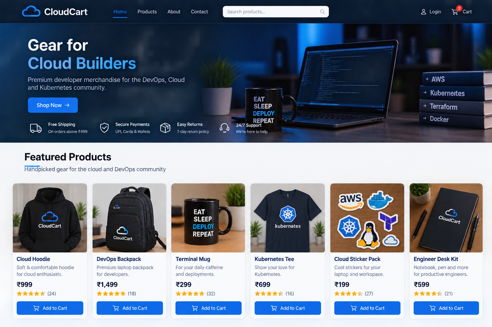
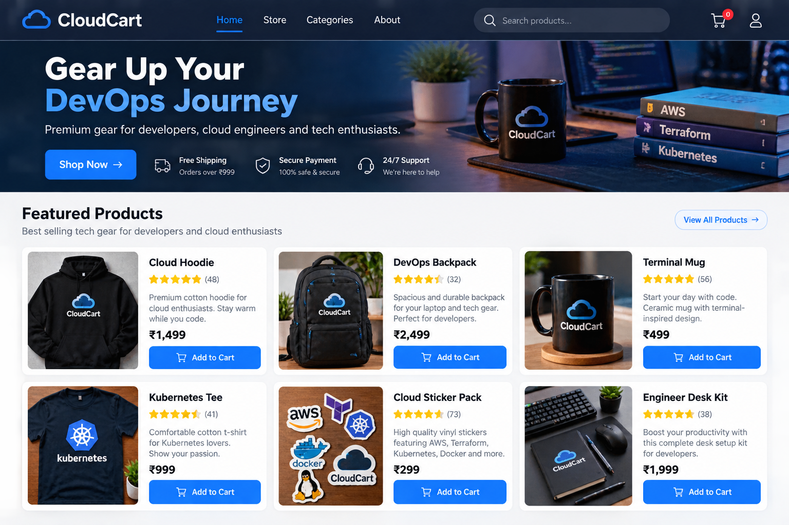
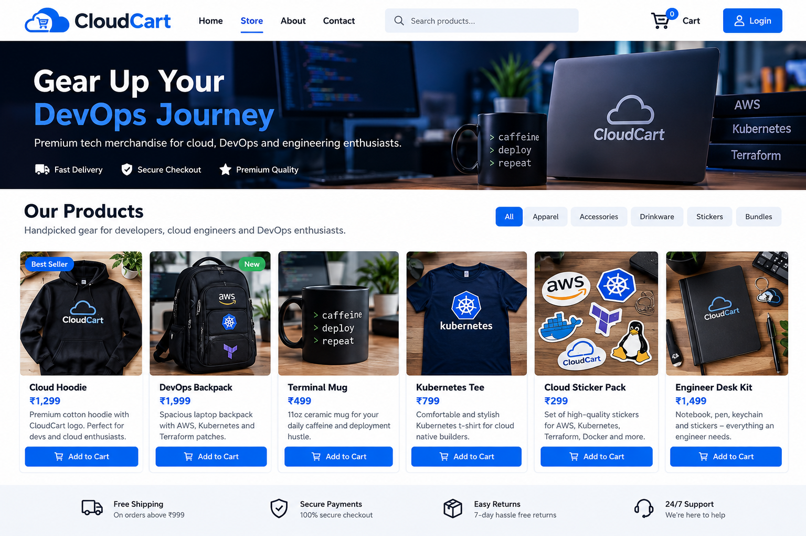
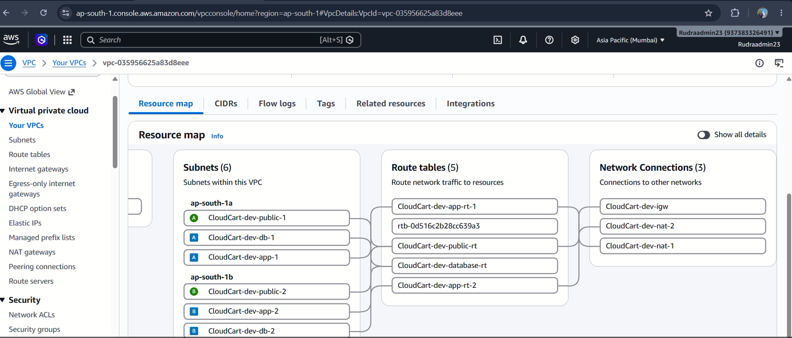
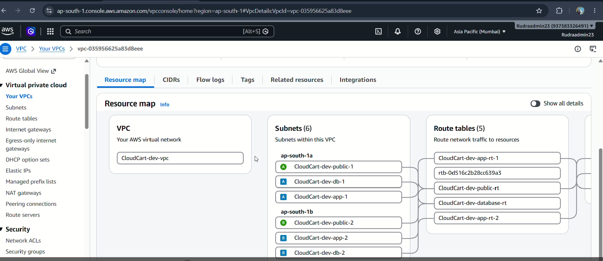

# CloudCart — DevSecOps E-Commerce Platform

<p align="center">
  
</p>

<p align="center">
  A full-stack e-commerce application showcasing AWS networking, Infrastructure as Code, containerization, Kubernetes, CI/CD, and security-focused cloud engineering.
</p>

<p align="center">
  <a href="https://github.com/rudrapuhan96-spec/cloudcart-devsecops-platform">GitHub Repository</a> ·
  <b>AWS</b> · <b>Terraform</b> · <b>Docker</b> · <b>Kubernetes</b> · <b>DevSecOps</b>
</p>

---

## Project Overview

CloudCart is a cloud-native e-commerce and DevSecOps portfolio project that brings application development and cloud infrastructure together. It combines a customer-facing shopping experience, backend APIs, order management, AWS networking, infrastructure automation, containerization, and Kubernetes deployment configuration.

The repository includes application source code, Terraform infrastructure, deployment resources, GitHub Actions workflow evidence, AWS screenshots, and demonstration videos.

## Project Highlights

- **Full-stack e-commerce:** Product browsing, shopping cart, checkout, and order creation.
- **Admin Orders Portal:** Administrative order review and customer/order information.
- **Order confirmation:** Email confirmation workflow, with successful delivery reported during testing.
- **AWS networking:** VPC, public and private subnets, route tables, NAT Gateways, Elastic IPs, Security Groups, and Network ACLs.
- **Infrastructure as Code:** Terraform configuration for cloud resource provisioning.
- **Containerization:** Docker image builds and container execution.
- **Container platform:** Amazon ECR, Amazon EKS, and Kubernetes resources.
- **CI/CD:** GitHub Actions workflow and supporting evidence.
- **Project documentation:** Screenshots, infrastructure captures, and demo videos.

## Architecture

```text
                      Customer / Administrator
                                |
                                v
                       CloudCart Frontend
                         React + Vite
                                |
                          /api proxy
                                |
                                v
                       Node.js / Express
                                |
                  +-------------+-------------+
                  |             |             |
                  v             v             v
               Products       Orders      Email Workflow
                                |
                                v
                         Admin Orders Portal


                    Cloud Infrastructure and Delivery
                                |
             +------------------+------------------+
             |                  |                  |
             v                  v                  v
          Terraform        GitHub Actions        AWS
             |                  |                  |
             v                  v                  v
         AWS Resources      Docker Build      VPC / S3 / ECR
                                                   |
                                                   v
                                              Amazon EKS
                                             Kubernetes
```

*This is a logical architecture overview. The actual running services and integrations depend on the current deployment and configuration.*

## Technology Stack

| Area | Technologies |
|---|---|
| Frontend | React, TypeScript, Vite |
| Backend | Node.js, Express |
| Database | MySQL |
| Containers | Docker |
| Cloud | Amazon Web Services (AWS) |
| Networking | VPC, subnets, route tables, NAT Gateways, Security Groups, Network ACLs |
| Infrastructure as Code | Terraform |
| Container registry | Amazon ECR |
| Orchestration | Kubernetes, Amazon EKS |
| Automation | GitHub Actions |
| Web server / proxy | NGINX |
| Version control | Git, GitHub |
| Operations | PowerShell, AWS CLI, kubectl |

## AWS Networking and Infrastructure

The project includes infrastructure work covering the following AWS components:

| Component | Purpose |
|---|---|
| Amazon VPC | Isolated cloud network |
| Public and private subnets | Network segmentation |
| Internet Gateway | Internet connectivity for appropriate public resources |
| NAT Gateways | Outbound connectivity for private resources |
| Route tables | Traffic routing between network destinations |
| Elastic IPs | Static public IPv4 addresses |
| Security Groups | Stateful traffic controls |
| Network ACLs | Subnet-level traffic controls |
| Amazon S3 | Object storage |
| Amazon ECR | Container image registry |
| Amazon EKS | Managed Kubernetes service |
| Terraform | Infrastructure provisioning and lifecycle management |

## Application Features

### Customer Store

- Browse products.
- Add products to the shopping cart.
- Submit checkout and delivery information.
- Create orders and receive an order identifier.
- Use the order confirmation workflow.

### Admin Orders Portal

The project includes an administrative order workflow for reviewing submitted orders and their associated details:

- Order ID and timestamp
- Customer name, email, and phone number
- Delivery address
- Ordered products, quantities, and total
- Payment method and order status

Admin access, order persistence, and checkout behavior were reported as tested. Production use still requires secure authorization, correct configuration, and validation in the target environment.

### Email Confirmation

The project includes an order confirmation email workflow. Successful email delivery was reported during testing. SMTP credentials, tokens, and other secrets must remain in environment configuration and must never be committed to Git.

## Screenshots and Project Evidence

### Application Showcase

<p align="center">
  
</p>

<p align="center">
  
</p>

<p align="center">
  
</p>

### AWS VPC Networking

**VPC network connections**



**VPC resource map**



### Infrastructure Evidence

| Evidence | Screenshot |
|---|---|
| Amazon EKS cluster | [View screenshot](app/frontend/public/showcase/images/eks-cluster.png) |
| NAT Gateways | [View screenshot](app/frontend/public/showcase/images/nat-gateways.png) |
| Route tables | [View screenshot](app/frontend/public/showcase/images/route-tables.png) |
| Security Groups | [View screenshot](app/frontend/public/showcase/images/security-groups.png) |
| Network ACLs | [View screenshot](app/frontend/public/showcase/images/network-acls.png) |
| Elastic IP addresses | [View screenshot](app/frontend/public/showcase/images/elastic-ips.png) |
| Elastic IP details | [View screenshot](app/frontend/public/showcase/images/elastic-ip-details.png) |
| S3 bucket | [View screenshot](app/frontend/public/showcase/images/s3-bucket.png) |
| Terraform plan | [View screenshot](app/frontend/public/showcase/images/terraform-plan.png) |
| Terraform terminal | [View screenshot](app/frontend/public/showcase/images/terraform-terminal.png) |
| GitHub Actions workflow | [View screenshot](app/frontend/public/showcase/images/github-actions-workflow.png) |

### Demo Videos

The videos are stored in `app/frontend/public/showcase/videos/` and tracked using Git LFS.

- [CloudCart DevSecOps Platform Demo](app/frontend/public/showcase/videos/CloudCart-DevSecOps-Platform-Demo.mp4.mp4)
- [AWS VPC Demo](app/frontend/public/showcase/videos/cloud%20cart%20vpc.mp4)
- [EC2 Demo](app/frontend/public/showcase/videos/EC2%20video.mp4)
- [Load Balancers Demo](app/frontend/public/showcase/videos/cloud%20cart%20load%20balancers%20.mp4)
- [Security Groups Demo](app/frontend/public/showcase/videos/cloud%20cart%20security%20groups%20.mp4)

## Repository Structure

```text
cloudcart-devsecops-platform/
├── .github/                  # GitHub workflow configuration
├── app/
│   ├── frontend/              # React + Vite application
│   │   └── public/showcase/   # Screenshots and demo videos
│   └── backend/               # Node.js API
├── database/                  # Database-related files
├── docs/                      # Documentation
├── infra/                     # Terraform infrastructure
├── k8s/                       # Kubernetes resources
├── helm/                      # Helm deployment resources
├── scripts/                   # Automation and utility scripts
└── README.md
```

*Directory descriptions are based on the intended project organization; check the actual repository if your local structure differs.*

## Getting Started

### Prerequisites

Install the tools needed for your chosen workflow:

- Git
- Node.js and npm
- Docker Desktop
- AWS CLI with an authorized AWS identity
- Terraform
- kubectl

AWS deployment requires a correctly configured AWS account and the relevant infrastructure. Docker and local application configuration may also be required.

### Clone the Repository

```powershell
git clone https://github.com/rudrapuhan96-spec/cloudcart-devsecops-platform.git
cd cloudcart-devsecops-platform
```

### Run the Frontend

```powershell
cd app/frontend
npm install
npm run dev
```

Open the local URL printed by Vite. Product, checkout, and order functionality also requires a running backend and correctly configured database.

### Run the Backend

```powershell
cd app/backend
npm install
```

Configure the required environment variables, then use the start script defined in the backend's `package.json`.

### Validate Terraform

```powershell
cd infra
terraform init
terraform validate
terraform plan
```

Review the plan before applying any infrastructure changes. AWS resources can incur charges.

### Inspect Kubernetes Resources

With the correct cluster context configured:

```powershell
kubectl get pods,services,deployments -n cloudcart
```

Use the namespace and cluster appropriate to your deployment.

## Security Practices

- Never commit AWS access keys, passwords, SMTP credentials, tokens, or admin secrets.
- Keep `.env` files and sensitive Terraform state out of source control.
- Apply least-privilege IAM permissions.
- Restrict inbound network access to required ports and trusted sources.
- Enforce server-side authorization for administrative operations.
- Review container images and application dependencies for vulnerabilities.
- Review Terraform plans before applying infrastructure changes.
- Avoid exposing customer data or credentials in screenshots and recordings.

## Troubleshooting

**Frontend API errors:** Check the `/api` proxy, backend availability, and API response format.

**Checkout errors:** Verify the database configuration, schema, and backend logs.

**Kubernetes unavailable:** Check the AWS identity, kubeconfig context, cluster status, and namespace.

**Docker connection errors:** Ensure Docker Desktop is running and its Linux engine is available.

**Unexpected AWS charges:** Review active resources in AWS Billing and Cost Management.

## Validation Checklist

The following checks were reported as completed during project testing:

- [x] Frontend loads and product APIs return JSON.
- [x] Checkout successfully creates an order.
- [x] Order details persist after a backend restart.
- [x] Admin authentication and authorization work as intended.
- [x] Customer confirmation emails are delivered.
- [x] Docker images build and containers start.
- [x] Terraform configuration validates and the plan matches the intended architecture.
- [x] Kubernetes workloads and networking are healthy.
- [x] GitHub Actions workflows complete successfully.
- [x] Screenshot and demo media paths are included in the README.

*These checks reflect the reported test results. They do not guarantee that cloud resources are still deployed or that every service is currently available.*

## Project Status

CloudCart is a hands-on portfolio project demonstrating full-stack development and cloud-native DevSecOps practices. The repository documents application workflows, AWS networking, infrastructure automation, containerization, Kubernetes, and deployment evidence.

## Author

**Rudra Shankar Puhan**

Cloud infrastructure · DevOps · Terraform · AWS networking · Secure application deployment

---

<p align="center">
  Built as a hands-on cloud and DevSecOps learning project.
</p>

<p align="center">
  <a href="https://github.com/rudrapuhan96-spec/cloudcart-devsecops-platform">Explore the CloudCart Repository</a>
</p>
