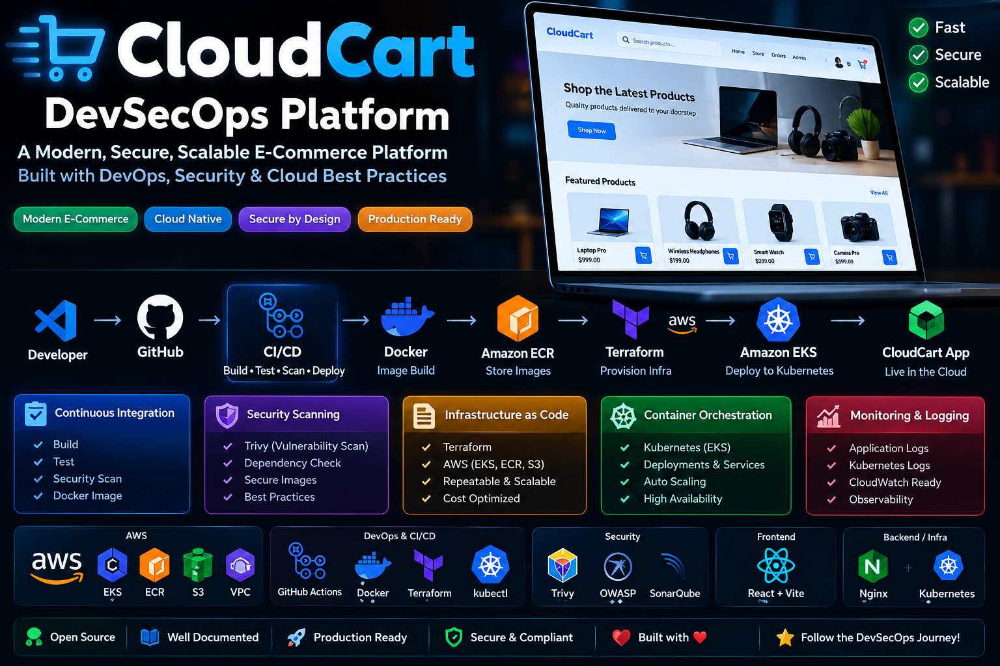

<p align="center">
  
</p>

<h1 align="center">CloudCart DevSecOps Platform</h1>

<p align="center">
  A cloud-native e-commerce application and DevSecOps portfolio project built with AWS, Docker, Kubernetes and Terraform.
</p>

<p align="center">
  <b>Cloud Infrastructure | Containerization | Infrastructure as Code | Deployment | Security</b>
</p>

---

## Overview

CloudCart is an e-commerce application designed to demonstrate application deployment and cloud infrastructure practices. The project combines a React frontend, a Node.js backend, container images, Kubernetes resources and AWS infrastructure configuration.

The repository includes application source code, deployment scripts, infrastructure configuration and Kubernetes manifests/templates.

## Key Features

- E-commerce storefront, cart and checkout pages
- Order tracking and administration interface
- React/Vite frontend and Node.js backend
- Docker-based container packaging
- Amazon ECR image repository configuration
- Amazon EKS and Kubernetes deployment configuration
- Terraform infrastructure as code
- AWS networking and S3 infrastructure configuration
- NGINX frontend configuration and API proxying
- Deployment scripts and project documentation

> Note: Actual service availability, CI/CD automation, security scans, monitoring and production readiness depend on the deployed configuration. Verify each capability before presenting it as operational.

## Architecture

```text
Customer / Administrator
          |
          v
     CloudCart UI
    React + Vite
          |
       NGINX
          |
       /api proxy
          |
          v
   Node.js / Express
          |
          v
        MySQL

Deployment and Infrastructure:
GitHub -> Docker -> Amazon ECR -> Amazon EKS
                              ^
                              |
                         Terraform
                              |
                             AWS
```

The diagram is a logical overview. Confirm the current deployed resources and CI/CD workflow before treating every connection as a live integration.

## Technology Stack

| Area | Technologies |
|---|---|
| Frontend | React, Vite, TypeScript |
| Backend | Node.js, Express |
| Database | MySQL |
| Containers | Docker |
| Orchestration | Kubernetes, Amazon EKS |
| Container Registry | Amazon ECR |
| Infrastructure as Code | Terraform |
| Cloud | AWS |
| Web Server / Proxy | NGINX |
| Source Control | Git, GitHub |
| Operations | PowerShell, AWS CLI, kubectl |

## Repository Structure

```text
.
├── app/
│   ├── frontend/
│   └── backend/
├── database/
├── docs/
├── infra/
├── k8s/
├── scripts/
├── security/
├── assets/
├── deploy.ps1
├── setup-cloudcart-deploy.ps1
└── README.md
```

Some directories or files may differ by branch or local setup.

## Application Pages

- Overview and architecture
- Security and CI/CD information pages
- Observability and evidence pages
- Store and shopping cart
- Checkout and order tracking
- Admin order management

## Getting Started

### Prerequisites

Install and configure the tools required for your chosen workflow:

- Git
- Node.js and npm
- Docker Desktop
- AWS CLI with an appropriately authorized AWS identity
- Terraform
- kubectl

An AWS account and a correctly configured cluster are required for AWS deployment.

### Clone the Repository

```powershell
git clone https://github.com/rudrapuhan96-spec/cloudcart-devsecops-platform.git
cd cloudcart-devsecops-platform
```

### Run the Frontend Locally

```powershell
cd app/frontend
npm install
npm run dev
```

Follow the Vite output for the local URL. Backend and database configuration may be required for checkout and order functionality.

### Validate Terraform Configuration

```powershell
cd infra
terraform init
terraform validate
terraform plan
```

Review the plan before applying any infrastructure changes. AWS resources can incur charges.

### Inspect Kubernetes Resources

From the project root, with a configured Kubernetes context:

```powershell
kubectl get pods,services,deployments -n cloudcart
```

Use only the Kubernetes context and namespace that match your environment.

## Security Practices

- Never commit AWS access keys, passwords, tokens or admin API keys.
- Keep `.env` files and Terraform state out of source control.
- Do not commit Terraform plan files or local backup files.
- Use least-privilege IAM permissions.
- Restrict public access to administrative interfaces.
- Review container images and dependencies for vulnerabilities.
- Avoid exposing customer data or credentials in screenshots and recordings.

## Troubleshooting

**Frontend API errors:** Check the NGINX `/api/` proxy and backend service connectivity.

**Checkout errors:** Verify database schema migrations and backend database configuration.

**Kubernetes unavailable:** Check the AWS identity, kubeconfig context, cluster status and namespace.

**Docker connection errors:** Ensure Docker Desktop is running and its Linux engine is available.

**Unexpected AWS charges:** Review active resources in the AWS Billing and Cost Management console.

## Project Status

This repository is intended as a practical DevSecOps portfolio project. Deployment status and individual capabilities should be verified against the current AWS environment before claiming production operation.

## Author

**Rudra Shankar Puhan**

Cloud, DevOps, infrastructure automation and secure application deployment.

---

<p align="center">
  Built as a hands-on cloud and DevSecOps learning project.
</p>

